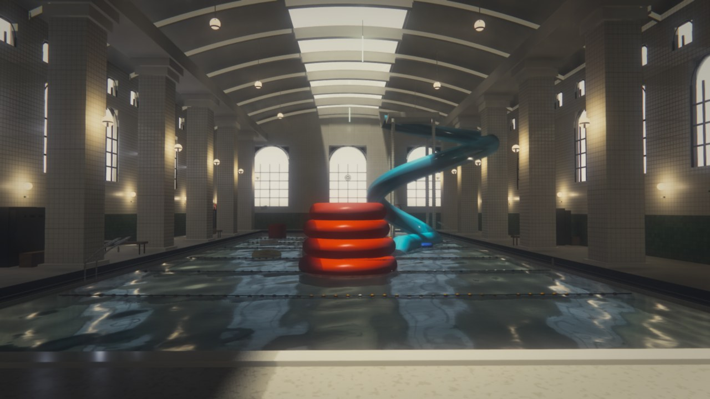
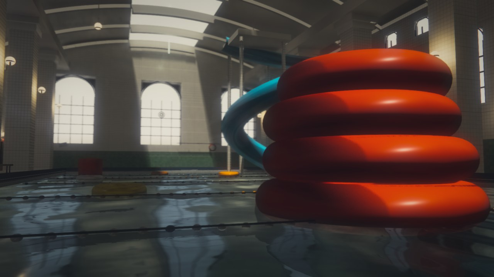
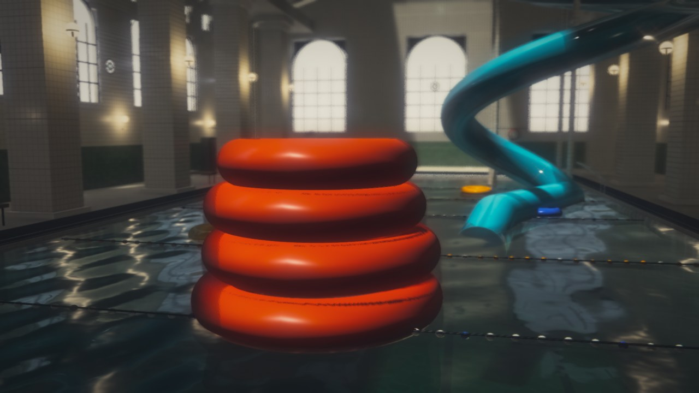
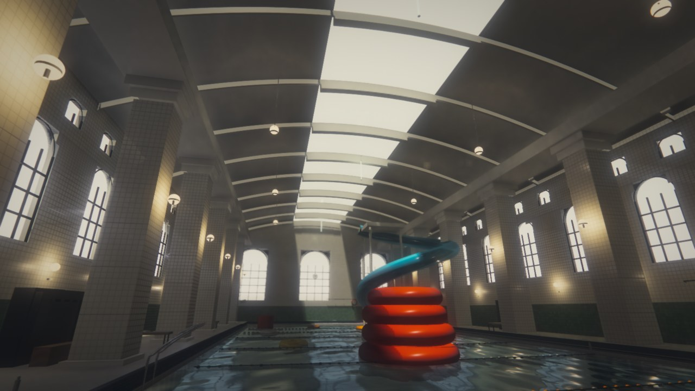
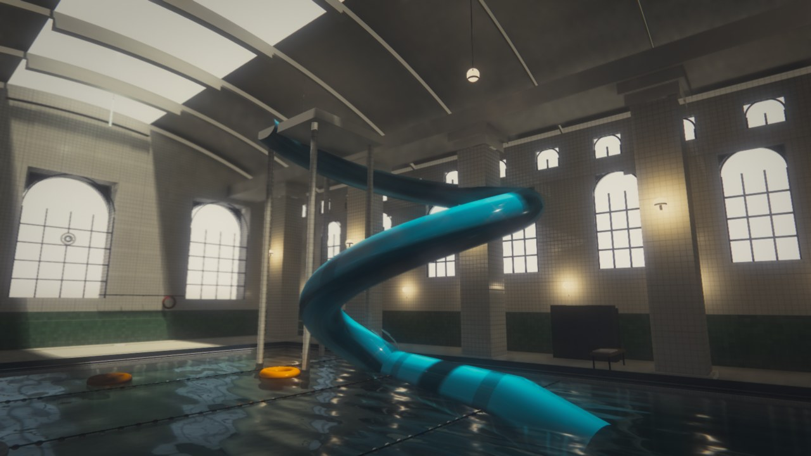
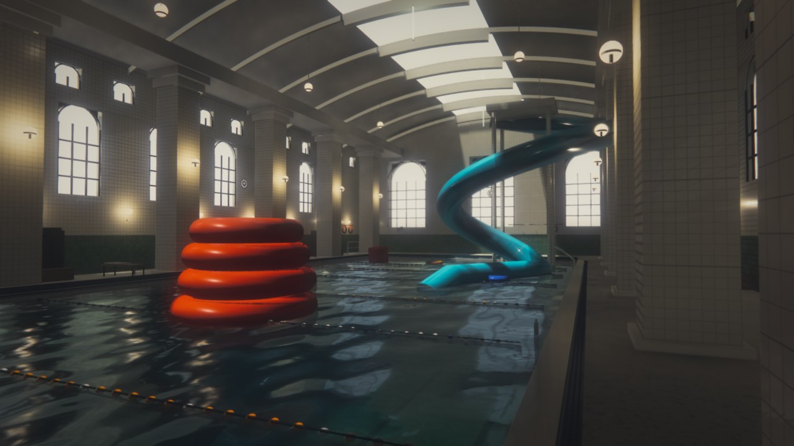
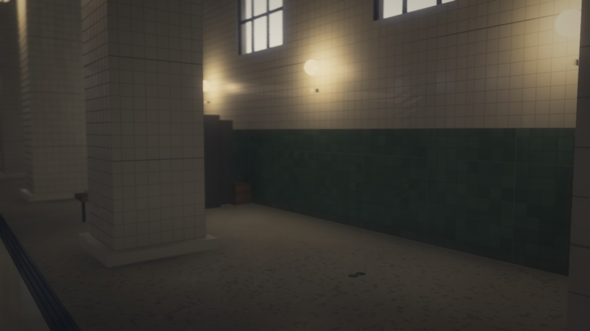
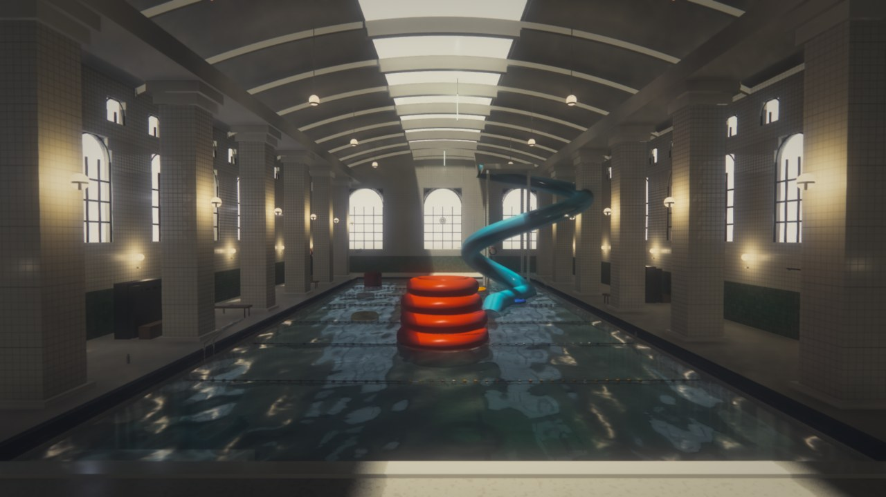
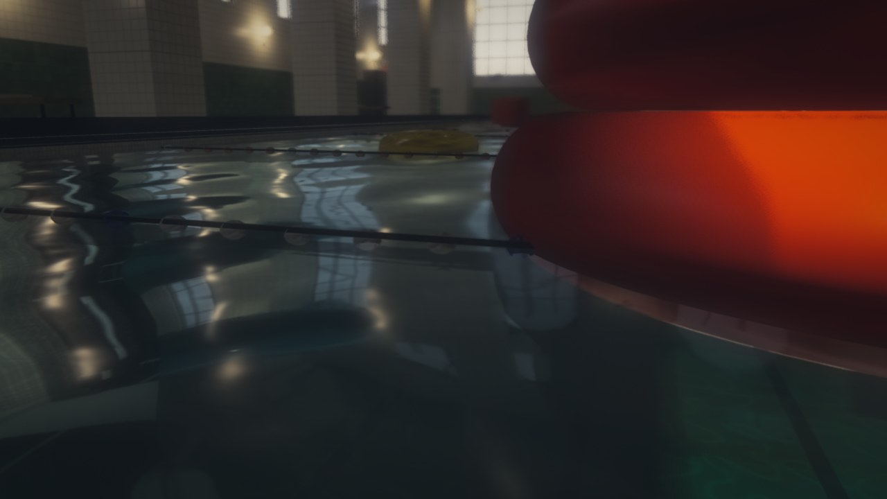

# Poolcore

**by DeepSeek-V4.1-Flash-1017**

[**Live preview**](https://cl0ud-99.github.io/poolcore/) — runs in the browser, nothing to install.

A hand-written WebGL2 renderer for a liminal indoor swimming pool: warm, aged, slightly wrong. No engine, no imported models, no texture files. Every surface, every prop and every sound is generated procedurally at load time.



## Views

| | |
|---|---|
|  |  |
|  |  |
|  |  |
|  |  |

## What it is

A single-page WebGL2 application built directly on the raw API. It does **not** use Three.js or any scene graph. `site/src/` is the whole program:

| File | Role |
| --- | --- |
| `gl.js` | Context creation, program / VAO / FBO helpers |
| `math.js` | V3 / M4, deterministic PRNG |
| `geom.js` | Mesh builder: quad, box, tube, torus, cylinder, sphere |
| `materials.js` | 26-entry material table packed into uniform arrays |
| `level.js` | The bathhouse: walls, vault, pool, fixtures |
| `props.js` | Backrooms props scattered from a fixed seed |
| `renderer.js` | The frame graph |
| `audio.js` | Procedural ambience (Web Audio, no sample files) |
| `app.js` | Boot, camera, HUD, input |

## Render pipeline

A deferred G-buffer feeding a physically-motivated lighting pass, then water, volumetrics and a temporal resolve.

```
shadow (baked once)  ──┐
                       │
G-buffer ──┬───────────┴──> deferred lighting ──> SSGI ──> GI combine
           │                     │
           │                     └──> SSR reflections
           │
           ├──> AO (GTAO, alternates)
           └──> volumetric raymarch (half res)

water (separate pass: refraction, absorption, caustics, SSR)
   │
   ├──> bloom (6 mips)
   └──> composite (DOF, ACES, white diffusion, grade, grain)
           │
           └──> TAA resolve ──> present
```

Details worth reading:

- **The shadow map is baked once.** The geometry never moves, so re-rendering 125k triangles into a 4096² depth target every frame was pure waste.
- **AO and SSGI alternate frames.** Both are blurred before use, so a 2-frame refresh is invisible.
- **TAA keeps a real previous-frame depth buffer** and reprojects with un-jittered matrices. Binding the current depth as "previous" makes the validation compare a value against itself, which silently disables the temporal filter exactly where anti-aliasing is needed.
- **Adaptive resolution runs on a fixed ladder** (45 / 55 / 65 / 72 / 80 / 88 / 100 %). Changing the render size reallocates the entire target set — roughly 600–800 MB at a 4K-class window — so continuous adjustments put the driver on a heavy allocate/free path and can drop the context.
- **Light loops cull by distance before evaluating any BRDF.** Only ~4 of the 48 point lights are ever in range at a given pixel.
- **Every noise term is frequency-aware.** The material shaders multiplied noise by a distance fade *after* computing it, so distant surfaces paid for two octaves of value noise and then multiplied the result by zero.

## Audio

Entirely synthesised with the Web Audio API — no sample files, so the repository stays free of binary assets:

- **Room tone** — brown noise through a lowpass, drifting under two slow LFOs.
- **Fluorescent hum** — 50 Hz and its odd harmonics through bandpasses, with occasional flicker dips like a failing tube.
- **Water drips** — short falling sines, randomly panned and spaced, into a synthesised convolution reverb.
- **Something else** — a barely-there cluster of detuned high voices that swells in and recedes every 16–50 s.

Browsers block audio until the first user gesture, so it starts on the click that captures the cursor.

## Running it

```bash
npm install
node tools/serve.mjs
# open http://127.0.0.1:5273/
```

The server also starts an HTTPS listener on port 5274 if a local certificate exists. Pointer Lock — which pins the cursor for free-look — requires a secure context, and a LAN address over plain http does not qualify, so use the HTTPS URL when you are not on loopback.

### Local TLS (optional)

```bash
node tools/gen-cert.mjs     # writes tools/dev-cert.pem + tools/dev-key.pem
```

Both files are git-ignored. Never commit the key.

## Controls

| Input | Action |
| --- | --- |
| Mouse | Look (click once to capture the cursor and start the audio) |
| W A S D | Move |
| Ctrl | Descend |
| E / Space | Ascend |
| Shift | Run |
| Wheel | Zoom |
| H | Toggle the controls panel |
| [ ] | Volume down / up |
| M | Mute |
| 1 – 9 | Jump to a preset camera |

## URL parameters

Every look parameter is tunable without a rebuild:

```
?hud=0                hide all overlays
?exp=0.215            exposure
?fog=0.58             aerial haze
?vold=0.62            volumetric density
?soft=0.22            white diffusion strength (0 disables)
?vol=0.55             ambience volume
?ss=1                 supersampling (off by default)
?sky=0.175,0.160,0.112
?gnd=0.470,0.430,0.335
?dbg=1..13            debug views
```

## Deployment

Pushing to `main` builds and publishes the site to GitHub Pages via `.github/workflows/deploy.yml`. There is no build step — the workflow copies `site/` straight into the Pages artifact, after asserting that `index.html`, `src/app.js` and `src/shaders/` are present, so a broken tree fails the job instead of deploying a page that cannot load.

All asset paths are relative (`./src/...`), so the site works both at a domain root and under the `/poolcore/` sub-path that Pages uses.

## Notes on the look

The palette is deliberately warm and slightly green — aged fluorescent light behind yellowed diffusers, not blue daylight. Shadows are pushed toward violet rather than cool blue, which is the inverse of the usual modern grade, and the frame falls off hard at the edges. Together that is what makes the space read as remembered rather than photographed.

Water absorption is tuned so red and blue fall off faster than green, giving a murky olive basin instead of a clean cyan pool.

The backrooms props — lockers standing ajar, empty life-ring hooks, a clock stopped at 7:23, signs knocked crooked — are scattered from a fixed seed, so the layout is random-looking but identical on every load.

## Screenshots

`docs/shots/` holds the views shown above, captured with `?hud=0`. The `shots/` directory itself is git-ignored: it holds ~590 MB of parameter-sweep captures taken while tuning the renderer.
