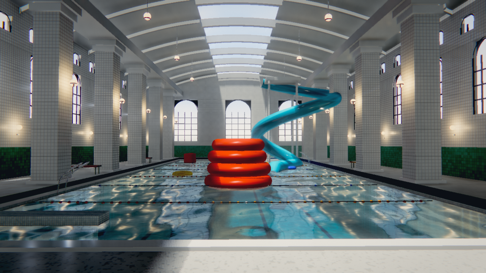

# Poolcore

A hand-written WebGL2 renderer for a liminal indoor swimming pool — warm, aged,
slightly wrong. No engine, no imported models, no texture files: every surface and
every piece of geometry is generated procedurally at load time.



<sub>Captured before the final warm-palette pass; the current build is warmer and
slightly greener than this frame.</sub>

## What it is

Poolcore is a single-page WebGL2 application built directly on the raw API. It
does **not** use Three.js or any scene graph. `site/src/` is the whole program:

| File | Role |
| --- | --- |
| `gl.js` | Context creation, program/VAO/FBO helpers |
| `math.js` | V3 / M4, deterministic PRNG |
| `geom.js` | Mesh builder (quad, box, tube, torus, cylinder, sphere) |
| `materials.js` | 25-entry material table packed into uniform arrays |
| `level.js` | The bathhouse itself: walls, vault, pool, fixtures |
| `props.js` | Backrooms props scattered from a fixed seed |
| `renderer.js` | The frame graph |
| `app.js` | Boot, camera, HUD, input |

## Render pipeline

A deferred G-buffer feeding a physically-motivated lighting pass, then water,
volumetrics and a temporal resolve.

```
shadow (baked once)  ──┐
                       │
G-buffer ──┬───────────┴──> deferred lighting ──> SSGI ──> GI combine
           │                     │
           │                     └──> SSR reflections
           │
           ├──> AO (GTAO, alternates)
           └──> volumetric raymarch (half res)

water (separate pass: refraction, absorption, caustics, SSR)
   │
   ├──> bloom (6 mips)
   └──> composite (DOF, ACES, grade, grain)
           │
           └──> TAA resolve ──> present (4-tap downsample)
```

Notable details:

- **Shadow map is baked once.** The geometry never moves, so re-rendering 125k
  triangles into a 4096² depth target every frame was pure waste.
- **AO and SSGI alternate frames.** Both are blurred before use, so a 2-frame
  refresh is invisible.
- **TAA keeps a real previous-frame depth buffer** and uses un-jittered matrices
  for reprojection — otherwise the neighbourhood clamp rejects history on every
  edge and the temporal filter silently does nothing.
- **Dynamic resolution** drops the internal buffer when frame time exceeds budget.
- **Light loops cull by distance before evaluating any BRDF.** Only ~4 of the 48
  point lights are ever in range at a given pixel.

## Running it

```bash
npm install
node tools/serve.mjs
# open http://127.0.0.1:5273/
```

The server also starts an HTTPS listener on `5274` if a local certificate exists.
Pointer Lock — which pins the cursor to the centre for free-look — requires a
secure context, and a LAN address over plain http does not qualify, so use the
HTTPS URL if you are not on loopback.

### Local TLS (optional)

```bash
node tools/gen-cert.mjs     # writes tools/dev-cert.pem + tools/dev-key.pem
```

Both files are git-ignored. Never commit the key.

## Controls

| Input | Action |
| --- | --- |
| Mouse | Look (click once to capture the cursor) |
| W A S D | Move |
| Ctrl | Descend |
| E / Space | Ascend |
| Shift | Run |
| Wheel | Zoom |
| H | Toggle the controls panel |
| 1 – 9 | Jump to a preset camera |

## URL parameters

Every look parameter is tunable without a rebuild:

```
?shot=hero|water|rings|vault|wide|colonn|slide|tile|edge
?exp=0.335     exposure
?fog=0.42      aerial haze
?vold=0.42     volumetric density
?ss=1.25       supersampling (off by default)
?sky=0.315,0.290,0.205
?gnd=0.760,0.700,0.560
?dbg=1..13     debug views
```

## Screenshots

The `shots/` directory is git-ignored: it holds ~588 MB of parameter-sweep
captures taken while tuning the lighting. Only the handful referenced by this
README are committed under `docs/`.

## Notes on the look

The palette is deliberately warm and slightly green — aged fluorescent light
behind yellowed diffusers, not blue daylight. Shadows are warm rather than cool,
which is the inverse of the usual modern grade and is what makes the space read as
"remembered" rather than "photographed".

Water absorption is tuned so red and blue fall off faster than green, giving a
murky olive basin instead of a clean cyan pool.
